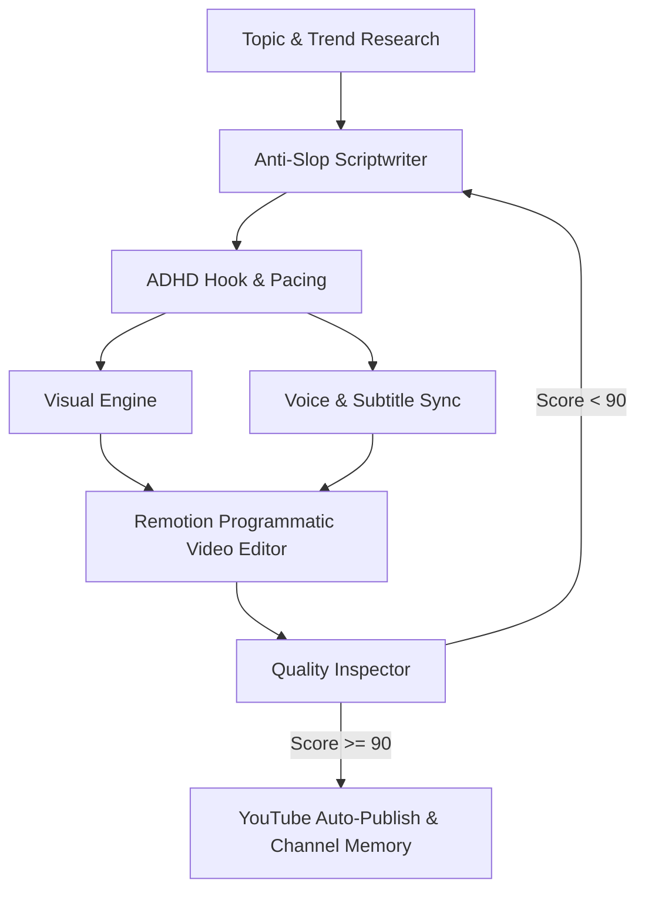

# 🎬 YouTube Autonomous Studio (Otonom YouTube Fabrikası)

Bu repo, **trend araştırmasından senaryo yazımına, görsel üretiminden seslendirmeye, programatik montajdan YouTube'a otomatik yüklemeye kadar** tüm süreci uçtan uca otonom olarak yöneten yeni nesil bir yapay zeka içerik stüdyosudur.

---

## 🧭 Referans Repolar ve Mimari Entegrasyon Haritası

Listelenen 24 açık kaynaklı repo incelenmiş ve her birinin en güçlü yönleri projenin mimarisine şu şekilde entegre edilmiştir:

| Aşama | Kullanılan Kaynak Repolar | Entegre Edilen Yetenek (Skill & Modül) |
|---|---|---|
| **1. Araştırma & Trend** | `yt-dlp`, `lfnovo/open-notebook`, `danielmiessler/fabric`, `find-skills` | YouTube trendleri, rakip transkript madenciliği (`extract_wisdom`), soru/yorum analizi (`skills/trend-research`). |
| **2. Senaryo & Hikaye** | `petergyang/no-ai-slop`, `jwynia/agent-skills/creative`, `virgiliojr94/book-to-skill` | Klişelerden ve yapaylıktan arındırılmış, samimi ve akıcı insan diliyle senaryo yazımı (`skills/anti-slop-writer`). |
| **3. Tutundurma & Tempo** | `ayghri/i-have-adhd`, `Jakeschincariol/replica-skill` | İlk 3 saniye kancası (Hook), ADHD retention pacing, merak döngüleri (Open-Loops), başarılı kanal tarzlarını klonlama (`skills/adhd-pacing-hook`). |
| **4. Görsel Estetik** | `Comfy-Org/ComfyUI`, `danielgatis/rembg`, `taste-skill`, `ui-ux-pro-max-skill`, `awesome-design-md`, `mcptoon` | Sinematik prompt mühendisliği, `rembg` ile şeffaf PNG cutout üretimi, thumbnail kompozisyon kuralları (`skills/taste-and-visual-direction`). |
| **5. Ses & Senkronizasyon** | `myshell-ai/OpenVoice`, `SYSTRAN/faster-whisper` | Doğal duygulu ses klonlama / TTS ve milisaniye hassasiyetinde kelime kelime altyazı zamanlaması (`skills/voice-and-sync`). |
| **6. Programatik Kurgu** | `remotion-dev/remotion` | React ve Node tabanlı kod ile video birleştirme, dinamik karaoke altyazılar, b-roll ve ses ducking (`skills/remotion-director`). |
| **7. Kalite Denetimi** | `NVIDIA/SkillSpector`, `usestrix/strix` | Yayın öncesi pre-flight denetim: AI slop kontrolü, ses kırpılması, altyazı taşması ve CTR potansiyel skoru (`skills/quality-inspector`). |
| **8. Dağıtım & Hafıza** | `darkzOGx/youtube-automation-agent`, `thedotmack/claude-mem`, `open-generative-ai`, `superpowers` | Geçmiş videoların performansını hatırlayan kanal hafızası ve YouTube Data API v3 ile otomatik yayınlama (`skills/channel-memory`). |

---

## 🏗️ Mimari ve İş Akışı



---

## 📂 Proje Dizin Yapısı

```text
youtube-autonomous-studio/
├── skills/                            # Ajan Becerileri (Agent Skills)
│   ├── trend-research/SKILL.md        # Trend ve transkript madenciliği
│   ├── anti-slop-writer/SKILL.md      # Robotik olmayan doğal senaryo
│   ├── adhd-pacing-hook/SKILL.md      # 3 saniye kancası & izlenme süresi optimizasyonu
│   ├── taste-and-visual-direction/SKILL.md # Estetik, renk ve thumbnail kuralları
│   ├── voice-and-sync/SKILL.md        # TTS ve kelime bazlı altyazı hizalama
│   ├── remotion-director/SKILL.md     # React tabanlı video montaj yönergeleri
│   ├── quality-inspector/SKILL.md     # Yayın öncesi kalite denetimi
│   └── channel-memory/SKILL.md        # Kanal geçmişi ve YouTube yükleme
│
├── pipeline/                          # Çekirdek Python Motorları
│   ├── researcher.py                  # yt-dlp & araştırma motoru
│   ├── scriptwriter.py                # Anti-slop senaryo üretici
│   ├── voice_engine.py                # TTS & Faster-Whisper entegrasyonu
│   ├── visual_engine.py               # ComfyUI API & rembg arkaplan silici
│   ├── remotion_render.py             # Remotion CLI orkestratörü
│   └── youtube_uploader.py            # YouTube Data API v3 yükleyici
│
├── remotion/                          # React Tabanlı Video Montaj Projesi
│   ├── package.json
│   └── src/
│       ├── index.ts
│       ├── Root.tsx
│       └── MainVideo.tsx              # Dinamik altyazı ve katman kompozisyonu
│
├── config/
│   ├── config.yaml.example            # Örnek konfigürasyon
│   └── channel_memory.json            # Kanal hafızası ve analitikleri
│
├── assets/                            # Üretilen medya varlıkları (Görseller, Cutout'lar)
├── output/                            # Çıktı klasörü (Ses, Senaryo, Final Video)
├── main.py                            # Tek komutla tüm hattı çalıştıran CLI
└── requirements.txt                   # Python bağımlılıkları
```

---

## 🚀 Hızlı Başlangıç (Kurulum ve Kullanım)

### 1. Gereksinimler
- Python 3.10+
- Node.js 18+ (Remotion için)
- FFmpeg (Sistem PATH'inde tanımlı olmalıdır)

### 2. Kurulum
```bash
# Python bağımlılıklarını kurun
pip install -r requirements.txt

# Remotion React kurgu paketlerini kurun
cd remotion
npm install
cd ..
```

### 3. Yapılandırma
`config/config.yaml.example` dosyasını `config/config.yaml` olarak kopyalayın ve kendi API anahtarlarınızı / tercihleriniz girin.

### 4. Tek Komutla Video Üretimi

```bash
# Sadece videoyu yerel olarak üretmek için:
python main.py --topic "2026 Yapay Zeka Devrimi ve Otonom Ajanlar"

# Üretip doğrudan YouTube'a (liste dışı) yüklemek için:
python main.py --topic "Yapay Zeka ile Kod Yazmanın Yeni Çağı" --auto-upload --privacy unlisted
```

### 5. Remotion Canlı Video Önizleme
Videoyu kod üzerinden canlı olarak incelemek ve tarayıcıda düzenlemek için:
```bash
cd remotion
npm start
```
