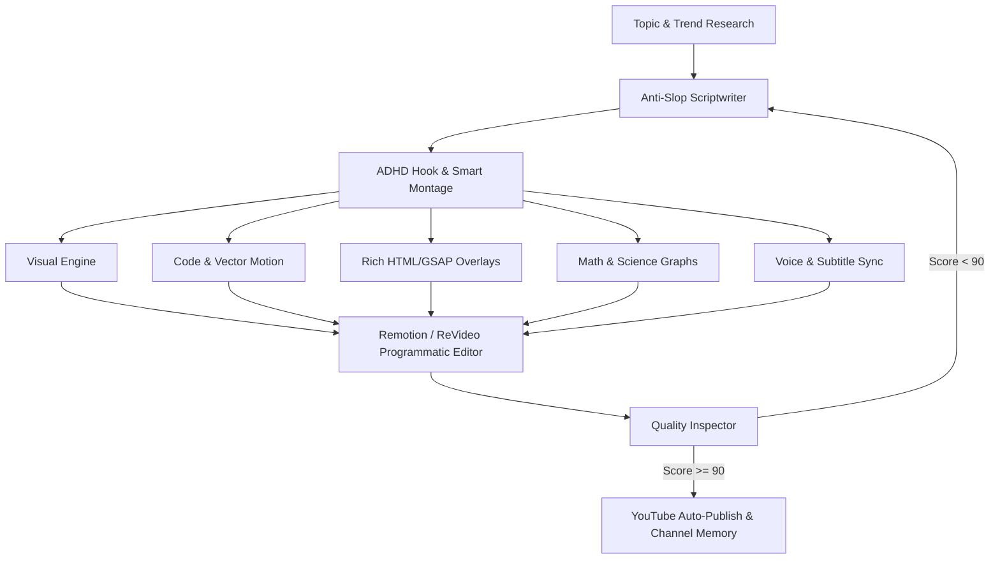

# 🎬 YouTube Autonomous Studio (Otonom YouTube Fabrikası)

Bu repo, **trend araştırmasından senaryo yazımına, görsel ve vektörel animasyon üretiminden seslendirmeye, programatik montajdan YouTube'a otomatik yüklemeye kadar** tüm süreci uçtan uca otonom olarak yöneten yeni nesil bir yapay zeka içerik stüdyosudur.

---

## 🧭 Referans Repolar ve Mimari Entegrasyon Haritası

Açık kaynak ekosisteminin en güçlü 29 projesinden faydalanılarak kurgulanmış mimari yetenek matrisi:

| Aşama | Kullanılan Kaynak Repolar | Entegre Edilen Yetenek (Skill & Modül) |
|---|---|---|
| **1. Araştırma & Trend** | `yt-dlp`, `lfnovo/open-notebook`, `danielmiessler/fabric`, `find-skills` | YouTube trendleri, rakip transkript madenciliği (`extract_wisdom`), soru/yorum analizi (`skills/trend-research`). |
| **2. Senaryo & Hikaye** | `petergyang/no-ai-slop`, `jwynia/agent-skills/creative`, `virgiliojr94/book-to-skill` | Klişelerden ve yapaylıktan arındırılmış, samimi ve akıcı insan diliyle senaryo yazımı (`skills/anti-slop-writer`). |
| **3. Tutundurma & Tempo** | `ayghri/i-have-adhd`, `Jakeschincariol/replica-skill` | İlk 3 saniye kancası (Hook), ADHD retention pacing, merak döngüleri (Open-Loops), başarılı kanal tarzlarını klonlama (`skills/adhd-pacing-hook`). |
| **4. Akıllı Kurgu & B-Roll** | `calesthio/openmontage` | Otomatik sessizlik budama (Jump-Cut), semantik B-roll eşleştirme ve 3.2 saniye kuralı (`skills/smart-montage`). |
| **5. Vektörel & Kod Animasyonları** | `motion-canvas/motion-canvas` | Modern syntax highlight, kod yazılma animasyonları ve sistem akış diyagramları (`skills/motion-canvas`). |
| **6. HTML/CSS Frame Motoru** | `heygen-com/hyperframes` | LLM ile doğrudan üretilen Tailwind CSS ve GSAP animasyonlu zengin istatistik ve metrik kartları (`skills/hyperframes-director`). |
| **7. Matematik & Bilim Grafikleri** | `manimCommunity/manim` | 3Blue1Brown tarzı Python ile matris, nöral ağ ve benchmark eğrileri görselleştirme (`skills/manim-explainer`). |
| **8. Görsel Estetik** | `ComfyUI`, `rembg`, `taste-skill`, `ui-ux-pro-max-skill`, `awesome-design-md`, `mcptoon` | Sinematik prompt mühendisliği, `rembg` ile şeffaf PNG cutout üretimi, thumbnail kompozisyon kuralları (`skills/taste-and-visual-direction`). |
| **9. Ses & Senkronizasyon** | `myshell-ai/OpenVoice`, `SYSTRAN/faster-whisper` | Doğal duygulu ses klonlama / TTS ve milisaniye hassasiyetinde kelime kelime altyazı zamanlaması (`skills/voice-and-sync`). |
| **10. Programatik Montaj** | `remotion-dev/remotion` *(Yedek: `midrender/revideo`)* | React ve Node tabanlı kod ile video birleştirme, dinamik karaoke altyazılar, b-roll ve ses ducking (`skills/remotion-director`). |
| **11. Kalite Denetimi** | `NVIDIA/SkillSpector`, `usestrix/strix` | Yayın öncesi pre-flight denetim: AI slop kontrolü, ses kırpılması, altyazı taşması ve CTR potansiyel skoru (`skills/quality-inspector`). |
| **12. Dağıtım & Hafıza** | `darkzOGx/youtube-automation-agent`, `thedotmack/claude-mem`, `open-generative-ai`, `superpowers` | Geçmiş videoların performansını hatırlayan kanal hafızası ve YouTube Data API v3 ile otomatik yayınlama (`skills/channel-memory`). |

---

## 🏗️ Genişletilmiş Mimari İş Akışı



---

## 📂 Güncel Proje Dizin Yapısı

```text
youtube-autonomous-studio/
├── skills/                            # Ajan Becerileri (Agent Skills)
│   ├── trend-research/SKILL.md        # Trend ve transkript madenciliği
│   ├── anti-slop-writer/SKILL.md      # Robotik olmayan doğal senaryo
│   ├── adhd-pacing-hook/SKILL.md      # 3 saniye kancası & izlenme süresi
│   ├── smart-montage/SKILL.md         # OpenMontage akıllı kurgu & sessizlik budama
│   ├── hyperframes-director/SKILL.md  # HeyGen HTML/CSS/GSAP animasyonlu kartlar
│   ├── motion-canvas/SKILL.md         # Vektörel kod & mimari diyagramları
│   ├── manim-explainer/SKILL.md       # 3Blue1Brown matematik & bilim grafikleri
│   ├── taste-and-visual-direction/SKILL.md # Estetik ve thumbnail kuralları
│   ├── voice-and-sync/SKILL.md        # TTS ve kelime bazlı altyazı hizalama
│   ├── remotion-director/SKILL.md     # React tabanlı video montaj yönergeleri
│   ├── quality-inspector/SKILL.md     # Yayın öncesi kalite denetimi
│   └── channel-memory/SKILL.md        # Kanal geçmişi ve YouTube yükleme
│
├── pipeline/                          # Çekirdek Motorlar
│   ├── researcher.py                  # yt-dlp & araştırma motoru
│   ├── scriptwriter.py                # Anti-slop senaryo üretici
│   ├── voice_engine.py                # TTS & Faster-Whisper entegrasyonu
│   ├── visual_engine.py               # ComfyUI API & rembg arkaplan silici
│   ├── hyperframes_engine.py          # HTML/Tailwind/GSAP sahne üreteci
│   ├── manim_generator.py             # Python Manim sahne üreteci
│   ├── remotion_render.py             # Remotion CLI render motoru
│   └── youtube_uploader.py            # YouTube Data API v3 yükleyici
│
├── remotion/                          # React Video Montaj Projesi
├── config/                            # Yapılandırma & Kanal Hafızası
├── assets/                            # Üretilen görsel, animasyon ve cutout varlıkları
├── output/                            # Çıktı klasörü (Final MP4, WAV, Scriptler)
├── main.py                            # Tek komutla orkestrasyon CLI
└── requirements.txt                   # Python bağımlılıkları
```

---

## 🚀 Hızlı Başlangıç

```bash
# Kurulum
pip install -r requirements.txt
cd remotion && npm install && cd ..

# Tek Komutla Video Üretimi
python main.py --topic "Otonom Yapay Zeka Ajanları ile Kodlama"

# Remotion Canlı Önizleme
cd remotion && npm start
```
